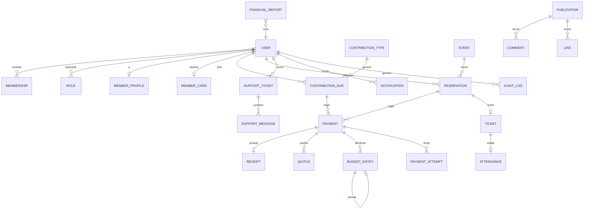

# Architecture

Monolithe Django modulaire : une application par domaine métier, logique métier dans `services.py` (transactions atomiques),
vues fines, contrôle d'accès dans `core/permissions.py`.

## Modèle conceptuel (simplifié)

## Machines d'états
- **Adhésion** : brouillon → en attente → vérification → acceptée / refusée ; acceptée ↔ suspendue ; → expirée (refusée → nouvelle soumission).
- **Paiement** : créé → en attente → en cours / vérification → confirmé / échoué / annulé ; confirmé → remboursé. Transitions codées dans `Payment.TRANSITIONS`.
- **Réservation** : en attente de paiement → confirmée / expirée / annulée ; gratuite : confirmée directement.
- **Billet** : valide → utilisé (une seule fois) / révoqué.
- **Opération financière** : en attente → validée (immuable) / rejetée ; correction = écriture inverse.
- **Rapport** : brouillon → validé (président) → publié (trésorier) ; nouvelle version par période.

## Choix techniques notables
- **MySQL** : pas d'index unique partiel (non supporté) → unicités métier garanties par verrous applicatifs + contraintes simples.
- Montants en `DecimalField(decimal_places=0)` (Ariary sans décimales) ; monnaie `MGA`.
- Numérotation sans trous ni doublons via `core.Sequence` (verrou `FOR UPDATE`).
- Fichiers privés : `private/` hors racine publique, accès par vues contrôlées ; seules les images publiques vont dans `media/`.
- Abstraction `payments/providers.py` : brancher l'API réelle = implémenter `initiate()` d'une sous-classe.
- Jobs : `expire_reservations` (toutes les 10 min) et `housekeeping` (quotidien) via cron.
